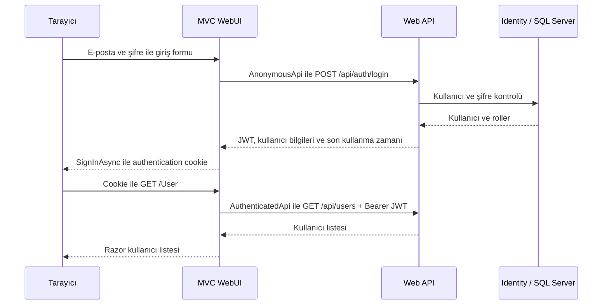

# AuthFlowLab

ASP.NET Core Web API ve MVC ile **kayıt, giriş, JWT, cookie ve yetkilendirme** akışını uçtan uca denemek için hazırlanmış bir öğrenme projesi.

API kullanıcıları ASP.NET Core Identity ile yönetir ve giriş sırasında JWT üretir. MVC uygulaması bu cevaptan kullanıcı oturumunu oluşturur; korumalı API isteklerinde JWT'yi sunucu tarafında gönderir.

## Kullanılan teknolojiler

- .NET 8 / ASP.NET Core
- ASP.NET Core Identity
- Entity Framework Core 8 ve SQL Server
- JWT Bearer Authentication
- MVC Cookie Authentication
- Razor Views ve Swagger

## Özellikler

- Kullanıcı kaydı ve benzersiz e-posta kontrolü
- Identity şifre kuralları ve başarısız girişlerde hesap kilitleme
- Kayıt sırasında varsayılan `User` rolünün atanması
- Kullanıcı kimliği, ad, e-posta ve rol claim'leri içeren JWT
- MVC tarafında HttpOnly authentication cookie
- Beni hatırla seçeneği
- JWT süresiyle aynı zamanda sona eren MVC oturumu
- API ve MVC tarafında `[Authorize]` ile korunan kullanıcı listesi
- JWT reddedildiğinde MVC oturumunun kapatılıp login sayfasına yönlendirilmesi
- Form doğrulama, antiforgery kontrolü ve güvenli yerel `returnUrl`
- Kayıt, giriş, kullanıcı listesi ve erişim reddedildi sayfaları

## Proje yapısı

Aktif çözüm iki projeden oluşur:

```text
AuthFlowLab.API/
├── Controllers/       # Auth ve Users endpoint'leri
├── Contexts/          # Identity DbContext
├── Dtos/              # İstek ve cevap modelleri
├── Entities/          # AppUser ve AppRole
├── Migrations/        # Identity veritabanı şeması
└── Services/          # Register, Login, JWT ve kullanıcı listeleme

AuthFlowLab.WebUI/
├── Controllers/       # MVC sayfaları ve giriş/çıkış işlemleri
├── Dtos/              # API ile iletişim modelleri
├── Handlers/          # API isteklerine Bearer token ekleyen handler
├── Views/             # Razor sayfaları
└── wwwroot/           # CSS ve statik dosyalar

.config/dotnet-tools.json   # Projeye sabitlenmiş EF Core CLI
AuthFlowLab.sln
```

## Giriş akışı



| Taraf | Oturum doğrulama | Görev |
| --- | --- | --- |
| Web API | JWT Bearer | Token imzasını, issuer, audience ve süreyi doğrular. |
| MVC WebUI | Authentication cookie | Kullanıcı oturumunu ve MVC sayfalarına erişimi doğrular. |
| ApiAccessTokenHandler | Cookie ticket içindeki token | `access_token` değerini API isteğinin Authorization header'ına ekler. |

JWT, `AuthenticationProperties.StoreTokens` ile korumalı cookie ticket'ında saklanır. Tarayıcı JavaScript'ine veya localStorage'a yazılmaz. `AnonymousApi` kayıt ve giriş için, `AuthenticatedApi` ise giriş gerektiren API çağrıları için kullanılır.

## Kurulum

### 1. Gereksinimler

- .NET 8 SDK
- Erişilebilir bir SQL Server örneği
- Git

EF Core CLI sürümü proje içindeki tool manifest'te tanımlıdır.

### 2. Repoyu indir ve bağımlılıkları yükle

```bash
git clone https://github.com/furkanturkerr/AuthFlowLab.git
cd AuthFlowLab
dotnet restore AuthFlowLab.sln
dotnet tool restore
```

### 3. API ayarlarını oluştur

Repo kökünden:

```bash
cp AuthFlowLab.API/appsettings.example.json AuthFlowLab.API/appsettings.json
```

Oluşturduğun `appsettings.json` içinde şu alanları kendi ortamına göre doldur:

| Ayar | Açıklama |
| --- | --- |
| `ConnectionStrings:SqlServer` | SQL Server adresi, portu, veritabanı ve kimlik bilgileri. |
| `JwtSettings:Key` | En az 32 UTF-8 bayt uzunluğunda, rastgele ve gizli imzalama anahtarı. |
| `JwtSettings:Issuer` | Token'ı üreten uygulamanın adı. |
| `JwtSettings:Audience` | Token'ı kabul eden API'nin adı. |
| `JwtSettings:ExpirationMinutes` | Token'ın dakika cinsinden geçerlilik süresi. |

Rastgele bir anahtar oluşturmak için:

```bash
openssl rand -hex 32
```

Çıktıyı `JwtSettings:Key` alanına yaz. Örnek dosyadaki boş bağlantı ve anahtar alanları çalıştırmadan önce doldurulmalıdır.

SQL Server bağlantı biçimi:

```text
Server=localhost,1433;Database=AuthFlowLabDb;User Id=YOUR_USER;Password=YOUR_PASSWORD;TrustServerCertificate=True;
```

SQL Server farklı bir portta çalışıyorsa `1433` yerine o portu kullan. `TrustServerCertificate=True` yerel geliştirme içindir.

API'nin gerçek `appsettings.json` ve `appsettings.Development.json` dosyaları Git'e dahil edilmez. Yalnızca gizli değer içermeyen örnek dosya paylaşılır.

### 4. Veritabanını oluştur

Repo kökünden mevcut migration'ı uygula:

```bash
dotnet ef database update --project AuthFlowLab.API --startup-project AuthFlowLab.API
```

Bu adım Identity kullanıcı, rol, claim ve ilişki tablolarını oluşturur. SQL Server'ın açık ve bağlantı bilgilerinin doğru olması gerekir.

### 5. API ve WebUI'ı çalıştır

Birinci terminal:

```bash
dotnet run --project AuthFlowLab.API --launch-profile http
```

İkinci terminal:

```bash
dotnet run --project AuthFlowLab.WebUI --launch-profile http
```

| Uygulama | Yerel adres |
| --- | --- |
| MVC WebUI | http://localhost:5081 |
| API Swagger | http://localhost:5129/swagger |
| Kullanıcı listesi | http://localhost:5081/User |

WebUI'ın `appsettings.json` dosyasındaki `ApiSettings:BaseUrl` değeri varsayılan olarak `http://localhost:5129/` adresidir. API portunu değiştirirsen bu ayarı da güncelle.

Her iki uygulama için HTTPS launch profilleri de bulunur. HTTPS'e geçerken geliştirme sertifikasını ve WebUI'ın API adresini uygun şekilde ayarla.

## API endpoint'leri

| Metot | Endpoint | Erişim | Sonuç |
| --- | --- | --- | --- |
| POST | `/api/auth/register` | Anonim | Kullanıcı oluşturur ve `User` rolünü atar. |
| POST | `/api/auth/login` | Anonim | JWT, kullanıcı bilgileri, roller ve geçerlilik zamanı döndürür. |
| GET | `/api/users` | Geçerli JWT | Kullanıcıları ve rollerini listeler. |

`AuthFlowLab.API/AuthFlowLab.API.http` dosyasında örnek kayıt, giriş ve listeleme istekleri bulunur. Giriş cevabındaki `accessToken` değerini listeleme isteğinin token değişkenine kopyalayabilirsin.

## Elle test etme

1. Giriş yapmadan `/User` adresini aç: login sayfasına yönlendirilmelisin.
2. Kayıt sayfasından bir kullanıcı oluştur: login sayfasında başarı mesajı görünmeli.
3. Hatalı şifreyle giriş dene: hata mesajı görünmeli, oturum açılmamalı.
4. Doğru bilgilerle giriş yap: kullanıcı listesi açılmalı ve kayıtlı kullanıcı görünmeli.
5. Çıkış yap ve `/User` adresini tekrar aç: yeniden giriş istenmeli.
6. `GET /api/users` isteğini tokensız gönder: API `401 Unauthorized` dönmeli.
7. Aynı isteği girişten alınan geçerli Bearer token ile gönder: API `200 OK` dönmeli.
8. Zayıf şifre veya aynı e-posta ile kayıt dene: kayıt hataları formda gösterilmeli.

Derleme kontrolü:

```bash
dotnet build AuthFlowLab.sln
```

Projede henüz otomatik test projesi yoktur; yukarıdaki adımlar akışı manuel doğrulamak içindir.

## Mevcut kapsam

Bu proje kayıt ve giriş sistemini öğrenmek için hazırlanmıştır. Kullanıcı listesine giriş yapan her kullanıcı erişebilir; admin'e özel bir endpoint veya rol yönetim ekranı bulunmaz. Refresh token, e-posta doğrulama ve şifre sıfırlama akışları henüz eklenmemiştir.

MVC'de çıkış yapmak cookie oturumunu kapatır. Daha önce verilen JWT, son kullanma zamanına kadar geçerlidir; token iptal mekanizması bulunmaz.
